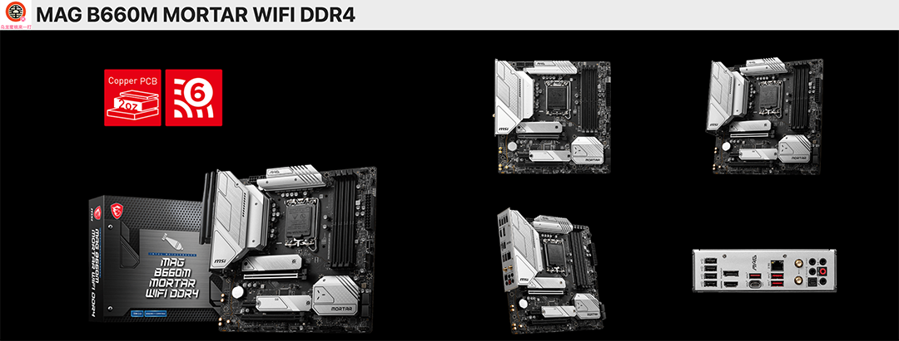
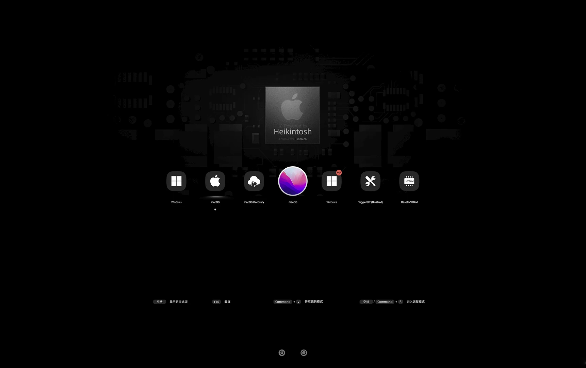

# EFI-MSI-MORTAR-B660M-Intel1700-AmdNavi21-BroadcomWireless-MacOS26Tahoe
Hackintosh macOS 26 system EFI driver configuration file based on MSI Mortar B660M motherboard + Intel 1700 platform CPU + AMD Navi21 and below architecture series + Broadcom network card.

基于微星迫击炮B660M 主板+英特尔 1700 平台CPU + AMD navi21 以下架构系列 + 博通网卡的黑苹果macOS 26 系统EFI 驱动配置文件。

### [English](README.EN.md)

[OpenCore 1.0.9](https://github.com/acidanthera/OpenCorePkg)

### 可安装系统
- macOS Tahoe 26.7.2

### 硬件配置

| 配置        | 型号                                                        |
|-------------|-------------------------------------------------------------|
| CPU         | 英特尔 13th Gen Intel Core i9-13900KF(ES Q0NW)              |
| 主板        | 微星 MSI MAG B660M MORTAR WiFi DDR4                         |
| 显卡        | AMD Radeon RX6600 Series ( 8 GB / 华硕DUAL雪豹 )            |
| 内存        | 96GB (金士顿野兽 DDR4 3200MHz)                              |
| SSD1        | 西数 WDS100T1X0E-00AFY0 (黑盘 SN850) (固态硬盘) 1TB --MacOS |
| SSD2        | 西数 WD_BLACK SN770 500GB (固态硬盘) --Windows11            |
| 机箱        | 九州风神 玄冰40 3F                                          |
| 电源        | 爱国者 ES650 650W                                           |
| CPU 风扇    | 利民 PA120 SE 塔式                                          |
| WiFi + 蓝牙 | 博通 BCM94360CD(FV-T919)                                    |

### Bios 设置

| Name        | Option |
|-------------|--------|
| Secure Boot | 关闭     |
| CFG Lock    | 关闭     |
| Fast Boot   | 关闭     |

### 注意事项

- 使用了最新的 `SimpleBCM.kext` 博通网卡驱动，不再需要手工打 OCLP 补丁了，简化系统升级流程（OTA增量更新）。如果出现 WiFi 不能自动连接的情况，请注意将 WiFi 密码加密强度设置为换成WPA3或者WPA2PKS/WPA3混合。
- 声卡由 `SimpleHDA.kext` 驱动，不再需要手工打 OCLP 补丁。
- 使用 [OCAuxiliaryTools](https://github.com/ic005k/OCAuxiliaryTools) 生成 SMBIOS，替换三码。

### 参考内容

[1.黑苹果安装过程演示](https://hackintosh.club/d/10000060)

[2.英特尔无线网卡WiFi驱动](https://hackintosh.club/d/10000015)

[3.英特尔无线网卡蓝牙驱动](https://hackintosh.club/d/10000017)

[4.我的B站黑苹果教程](https://space.bilibili.com/244390800/video)

[6.黑果之家](https://hackintosh.club)

### 系统截图

- OC引导

  

### 联系我们

- QQ群: 23304408

